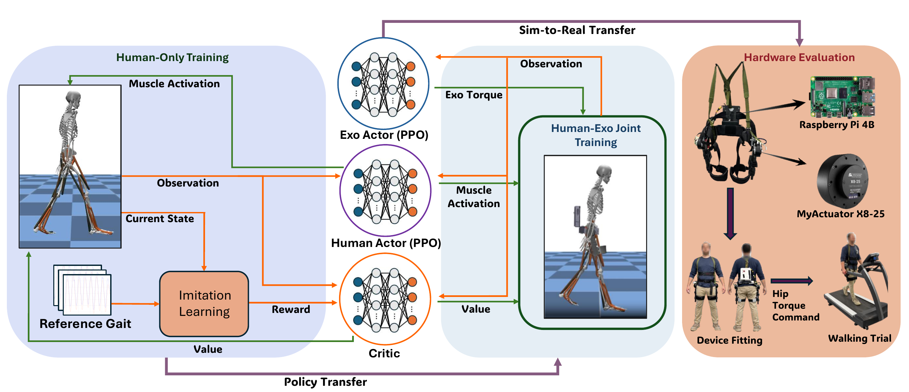

# SMAT-Exo

Code, training configurations and trained policies for

> **SMAT: Staged Multi-Agent Training for Co-Adaptive Exoskeleton Control.** IEEE/RSJ International Conference on Intelligent Robots and Systems (IROS), 2026.

[Project page](https://fitz-yuan.github.io/SMAT/) · [Paper (arXiv:2603.07618)](https://arxiv.org/abs/2603.07618)

<p align="center"></p>
<p align="center"><sub>Overview of SMAT (Fig. 1 of the paper).</sub></p>

SMAT trains a musculoskeletal human actor (26 muscles) and a bilateral hip exoskeleton actor with PPO, in four stages:

| Stage | What is trained | Config |
|---|---|---|
| 1. Baseline gait | Human actor imitates a 1.25 m/s reference gait; no exoskeleton | [`configs/stage1_baseline_gait.json`](configs/stage1_baseline_gait.json) |
| 2. Added exo mass | Human actor adapts to the attached exoskeleton; no assistance torque | [`configs/stage2_exo_mass.json`](configs/stage2_exo_mass.json) |
| 3. Assistance timing | Exo actor learns when to assist, with the human actor frozen | [`configs/stage3_assist_timing.json`](configs/stage3_assist_timing.json) |
| 4. Co-adaptation | Human and exo actors adapt to each other; the human actor also observes the exo torque | [`configs/stage4_coadaptation.json`](configs/stage4_coadaptation.json) |

The code is built on [MyoAssist](https://github.com/neumovelab/myoassist) (commit `c108837`) and [MyoSuite](https://github.com/MyoHub/myosuite).

## Installation

Tested with Python 3.11 on Ubuntu 22.04.

```bash
git clone https://github.com/Fitz-Yuan/SMAT-Exo.git
cd SMAT-Exo
python3.11 -m venv .venv && source .venv/bin/activate   # or: conda create -n smat python=3.11 && conda activate smat
pip install -e .
```

- Run all commands below from `rl_train/`; paths in the configs are relative to it.
- Evaluation renders a replay video. On a machine without a display, set `MUJOCO_GL=egl` (NVIDIA driver) or `MUJOCO_GL=osmesa`.
- A CUDA GPU is used if available; otherwise PPO runs on the CPU.
- Training runs one simulation process per environment (`env_params.num_envs`, 32 in the configs); lower it with `--config.env_params.num_envs 8` on smaller machines.

## Training the four stages

Train the stages in order. Each run is written to `rl_train/results/train_session_<date>-<time>/`, with checkpoints saved as `trained_models/model_<step>.zip`. Stages 2–4 start from a checkpoint of the previous stage, given with `--config.env_params.prev_trained_policy_path` (path without `.zip`).

```bash
cd rl_train

# Stage 1: baseline gait (from scratch)
python run_train.py --config_file_path ../configs/stage1_baseline_gait.json

# Stage 2: adapt to the exoskeleton mass, starting from the final Stage 1 checkpoint
python run_train.py --config_file_path ../configs/stage2_exo_mass.json \
    --config.env_params.prev_trained_policy_path results/<stage 1 session>/trained_models/model_<step>

# Stage 3: exo assistance timing, starting from the final Stage 2 checkpoint
python run_train.py --config_file_path ../configs/stage3_assist_timing.json \
    --config.env_params.prev_trained_policy_path results/<stage 2 session>/trained_models/model_<step>

# Stage 4: co-adaptation, starting from a Stage 3 checkpoint (see below)
python run_train.py --config_file_path ../configs/stage4_coadaptation.json \
    --config.env_params.prev_trained_policy_path results/<stage 3 session>/trained_models/model_<step>
```

What changes between the stages:

- **Stage 1** trains the human actor alone (`myoLeg26_BASELINE.xml`).
- **Stage 2** attaches the exoskeleton without assistance torque (`myoLeg26_hipexo_passive.xml`). The Stage 1 policy becomes the human actor of a two-actor network; the exo actor has no effect yet.
- **Stage 3** uses a small exo torque limit (`myoLeg26_hipexo_low_torque.xml`), re-initializes the exo actor (`reset_exo_only_after_load`), freezes the human actor (`freeze_human_actor`), disables the hip-flexion imitation terms and uses the Stage 3 exo reward of Eq. (4) (`exo_assistance_reward_type: "power_sign"`). This reward drives the exo torque towards saturation late in training; use the last checkpoint before the exo torque saturates as the starting point of Stage 4.
- **Stage 4** raises the exo torque limit to that of your exoskeleton's motors (`myoLeg26_hipexo.xml`; for another device, change `gainprm` and `forcerange` of the two exo motors in the model), unfreezes the human actor, extends its input with the two normalized exo torques (new input weights are randomly initialized; all other weights are loaded) and uses the power-based exo reward of Eq. (5) with the torque-rate penalty of Eq. (6). The exo torque saturates if training runs long; select a checkpoint before it does.

To check the exo torque of a checkpoint, evaluate it (next section) and inspect `exo_torque_lr_comparison.png` or the normalized torque range printed under "EXO TORQUE VERIFICATION".

Any config value can be overridden from the command line, e.g. `--config.total_timesteps 2000000`. Training is stochastic, so results vary between runs.

## Evaluate a checkpoint

```bash
cd rl_train
python run_policy_eval.py ../checkpoints/stage4_coadaptation/model.zip           # released checkpoint
python run_policy_eval.py results/<session>/trained_models/model_<step>.zip     # your own checkpoint
```

This rolls out the checkpoint at 1.25 m/s and writes an `analyze_results_<checkpoint name>/` folder next to the checkpoint (for your own runs, to the session folder): the recorded gait (`gait_evaluated_data.json`), kinematics, muscle activation and exo torque/power plots, a replay video and, for your own runs, the training reward curves. Each rollout starts at a random phase of the reference gait; if the model falls before the end, the script retries from a new random start (up to 5 attempts).

## Released checkpoints

[`checkpoints/`](checkpoints) contains one checkpoint per stage (`model.zip`), together with the configuration used to load and evaluate it (`session_config.json`, a copy of the stage's file in [`configs/`](configs)). These are the checkpoints used in the paper; each stage was started from the checkpoint of the previous stage. They were trained with an earlier version of this code, and their training settings differ in some respects from the configurations in [`configs/`](configs).

| Stage | Checkpoint | Training steps | Use in the paper |
|---|---|---|---|
| 1 | `checkpoints/stage1_baseline_gait/model.zip` | 300.5 M | Initialization of Stage 2 |
| 2 | `checkpoints/stage2_exo_mass/model.zip` | 156.4 M | Initialization of Stage 3 |
| 3 | `checkpoints/stage3_assist_timing/model.zip` | 1.1 M | Initialization of Stage 4 |
| 4 | `checkpoints/stage4_coadaptation/model.zip` | 2.0 M (including the 1.1 M of Stage 3) | Policy deployed on the exoskeleton (Sec. III-C, Table IV, Fig. 7) and used for Fig. 6 |

## Configuration reference

| Paper | Configuration |
|---|---|
| Exoskeleton and torque limit τ_max | `env_params.model_path` |
| Reward terms and weights (Table I) | `env_params.reward_keys_and_weights` |
| Exo reward of Stage 3 (Eq. 4) / Stage 4 (Eq. 5) | `env_params.exo_assistance_reward_type`: `"power_sign"` / `"power"` |
| Re-initializing the exo actor | `policy_params.custom_policy_params.reset_exo_only_after_load` |
| Freezing an actor | `freeze_human_actor`, `freeze_exo_actor` |
| Observation of each actor, incl. the 2 exo-torque inputs of the human actor in Stage 4 | `net_indexing_info` (index ranges into the full observation) |
| Network sizes | `net_arch` |
| PPO hyperparameters (Table II) | `ppo_params` |
| Exo history (3 steps of hip angles, velocities and commands) | `env_params.exo_history_input_frames` (2 past + current), `exo_history_output_frames` (3) |

The exoskeleton is drawn with simple shapes (a belt, hip plates and thigh struts); its parts do not collide and their masses and inertias are given explicitly in the model.

## Hardware deployment

[`hardware/exo_policy.py`](hardware/exo_policy.py) runs the exo actor of a Stage 4 checkpoint with only `numpy` and `torch`. It takes the bilateral hip angles and velocities (rad, rad/s, flexion positive) at 50 Hz and returns normalized torques in [-1, 1], which are scaled by the device torque limit (10 and 15 Nm in the human experiments).

```python
from exo_policy import SMATExoPolicy
policy = SMATExoPolicy("checkpoints/stage4_coadaptation/model.zip")   # or one of your own Stage 4 checkpoints
u_right, u_left = policy.step(r_angle, l_angle, r_velocity, l_velocity)
```

`python hardware/exo_policy.py <checkpoint.zip>` prints the output for a synthetic hip trajectory.

This repository contains only the control policy. The mechanical design (CAD) of the exoskeleton and its motor drivers, communication and safety software are not released; the main hardware specifications are listed in Table III of the paper.

## Data

Human-subject data from the treadmill experiments are not included. The offline validation in Fig. 6 used the open dataset of Molinaro et al., *Nature* 635, 337–344 (2024), which is not redistributed here.

## Citation

```bibtex
@inproceedings{yuan2026smat,
  title     = {{SMAT}: Staged Multi-Agent Training for Co-Adaptive Exoskeleton Control},
  author    = {Yuan, Yifei and Androwis, Ghaith and Zhou, Xianlian},
  booktitle = {IEEE/RSJ International Conference on Intelligent Robots and Systems (IROS)},
  year      = {2026}
}
```

Please also cite MyoAssist and MyoSuite if you use this code.

## Acknowledgments

This work was supported by NSF Award #2524089 and NIDILRR RERC Grant 90REGE0025-01-00. The simulation environment, musculoskeletal model, imitation rewards and PPO actor–critic implementation come from MyoAssist (NeuMove Lab, Northeastern University) and MyoSuite.

## License

Apache License 2.0, see [LICENSE](LICENSE). See [NOTICE](NOTICE) for attribution and the list of changes relative to MyoAssist.
